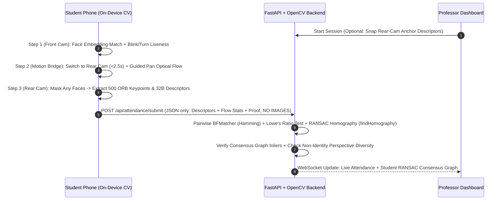

# VisioAttend: Privacy-Preserving Classroom Attendance via Dual-Camera Computer Vision

[](https://opensource.org/licenses/MIT)
[](https://fastapi.tiangolo.com)
[](https://reactjs.org/)
[](https://opencv.org/)
[](#privacy-guarantees)

VisioAttend is an attendance verification system built for university Computer Vision coursework that mathematically guarantees **zero raw images or video frames ever leave student devices**.

---

## Table of Contents
1. [Core Problem & The Privacy Constraint](#1-core-problem--the-privacy-constraint)
2. [End-to-End Computer Vision Pipeline](#2-end-to-end-computer-vision-pipeline)
   - [Phase 0: Local-First Student Enrollment](#phase-0-local-first-student-enrollment)
   - [Phase 1: Front Camera Face Verification & Liveness](#phase-1-front-camera-face-verification--liveness)
   - [Phase 2: The Motion-Continuity Bridge (Optical Flow Anti-Spoofing)](#phase-2-the-motion-continuity-bridge-optical-flow-anti-spoofing)
   - [Phase 3: Rear Camera Privacy-Safe Feature Extraction](#phase-3-rear-camera-privacy-safe-feature-extraction)
   - [Phase 4: Backend Geometric Consensus Engine](#phase-4-backend-geometric-consensus-engine)
3. [Anti-Spoofing & Threat Model](#3-anti-spoofing--threat-model)
4. [The "Privacy Inspector" (Student Transparency)](#4-the-privacy-inspector-student-transparency)
5. [Interactive Professor Consensus Graph](#5-interactive-professor-consensus-graph)
6. [Exact Data Schema (`POST /api/attendance/submit`)](#6-exact-data-schema-post-apiattendancesubmit)
7. [System Architecture Diagram](#7-system-architecture-diagram)
8. [Getting Started & Local Execution](#8-getting-started--local-execution)
   - [Automated One-Click Startup](#automated-one-click-startup)
   - [Manual Step-by-Step Setup](#manual-step-by-step-setup)
   - [Running the Pytest Suite](#running-the-pytest-suite)
9. [1-Click Classroom Simulation Mode](#9-1-click-classroom-simulation-mode)
10. [Repository Structure](#10-repository-structure)

---

## 1. Core Problem & The Privacy Constraint

University attendance systems often face a dilemma:
- QR codes and BLE beacons can easily be forwarded to remote cheaters staying in their dorm rooms.
- Traditional face-recognition attendance requires uploading student face pictures to an institutional server, violating privacy and creating security risks.

**VisioAttend solves both challenges simultaneously:**
1. **Front Camera (Selfie):** Verifies the student's identity and active liveness locally in WebAssembly.
2. **Rear Camera (Environment):** Captures an arbitrary physical classroom target chosen on the fly by the professor (e.g., a section of the whiteboard or a corner of the room). **No projector or QR code required.**
3. **Strict Privacy Guarantee:** **ZERO raw images or video frames ever leave the student device.** All face processing, landmark tracking, optical flow analysis, bystander redaction, and ORB feature extraction happen 100% on-device in browser RAM. Only compact, non-invertible mathematical signatures (~18 KB JSON payload) are transmitted to the verification server.

---

## 2. End-to-End Computer Vision Pipeline

```
+--------------------------------------------------------------------------------------------------+
|                                    STUDENT DEVICE (ON-DEVICE CV)                                 |
|                                                                                                  |
| [Step 0: Enrollment]      [Step 1: Front Cam]        [Step 2: Motion Bridge]    [Step 3: Rear]   |
| 128-D Face Embedding  --> 3D Landmarks EAR / Yaw --> Guided Micro-Pan LK   --> Mask Faces +      |
| + Salted SHA-256 Hash     Cosine Sim >= 0.65         calcOpticalFlowPyrLK       500 ORB KPs/Desc |
+----------------------------------------------------------------------------------------+---------+
                                                                                         |
                                                                                         | ~18 KB JSON
                                                                                         v (NO IMAGES)
+--------------------------------------------------------------------------------------------------+
|                                   FASTAPI + OPENCV BACKEND ENGINE                                |
|                                                                                                  |
| [Pairwise BFMatcher (Hamming)] -> [Lowe's Ratio Test (tau=0.75)] -> [RANSAC findHomography (5px)]|
|                                                                                                  |
| [NetworkX Consensus Graph]    -> Dominant Component (Inliers >= 15)  --> PRESENT / OUTLIER       |
+--------------------------------------------------------------------------------------------------+
```

### Phase 0: Local-First Student Enrollment
1. When a student opens the application for the first time, they capture 3 selfie angles (neutral, slight left, slight right).
2. The on-device engine computes their **128-D normalized face embedding vector** $\mathbf{e}_{\text{enrolled}} \in \mathbb{R}^{128}$.
3. $\mathbf{e}_{\text{enrolled}}$ is saved locally in browser storage. Only a salted cryptographic commitment hash $H(\mathbf{e}_{\text{enrolled}} \parallel \text{salt})$ is registered with the backend.

### Phase 1: Front Camera Face Verification & Liveness
When an attendance session begins:
1. The front camera opens (`facingMode: "user"`).
2. **Active Micro-Challenge:** The student is prompted with a randomized liveness challenge:
   - **Blink Challenge:** Evaluates Eye Aspect Ratio (EAR) across 6 eye landmarks:
     $$\text{EAR} = \frac{\|\mathbf{p}_2 - \mathbf{p}_6\| + \|\mathbf{p}_3 - \mathbf{p}_5\|}{2 \|\mathbf{p}_1 - \mathbf{p}_4\|}$$
     A valid blink requires an initial dip below $0.20$ followed by a recovery above $0.28$.
   - **Head Turn Challenge:** Tracks 3D yaw angle delta $\Delta \psi > 12^\circ$ using facial transformation moments.
3. **Identity Match:** Extracts the live embedding $\mathbf{e}_{\text{live}}$ and checks cosine similarity:
   $$S_{\text{cos}}(\mathbf{e}_{\text{live}}, \mathbf{e}_{\text{enrolled}}) = \frac{\mathbf{e}_{\text{live}} \cdot \mathbf{e}_{\text{enrolled}}}{\|\mathbf{e}_{\text{live}}\| \|\mathbf{e}_{\text{enrolled}}\|} \ge 0.65$$

### Phase 2: The Motion-Continuity Bridge (Optical Flow Anti-Spoofing)
Immediately following front camera verification (within 100ms):
1. **Switch Window Enforcement:** Measures the switch delta $\Delta t_{\text{switch}}$ between the front and rear cameras. If $\Delta t_{\text{switch}} > 2500\text{ ms}$, the submission is rejected to prevent swapping devices or spoofing virtual cameras.
2. **Guided Micro-Pan Optical Flow Challenge:**
   - As the rear camera opens, the app displays a randomized 1.2-second directional prompt: *"Pan slowly RIGHT $\rightarrow$"* (or LEFT / UP / DOWN).
   - Tracks Shi-Tomasi corners across consecutive frames using **Pyramidal Lucas-Kanade Optical Flow (`cv.calcOpticalFlowPyrLK`)**.
   - Computes the directional coherence score:
     $$C_{\text{flow}} = \frac{\left\| \sum_{k=1}^M \mathbf{v}_k \right\|}{\sum_{k=1}^M \|\mathbf{v}_k\|}$$
   - **Physics Verification:** Verifies that observed pixel motion matches the physical prompt (e.g., panning the smartphone right causes static world features to shift left in pixel coordinates), with $C_{\text{flow}} \in [0.65, 0.995]$.

### Phase 3: Rear Camera Privacy-Safe Feature Extraction
On the sharpest rear-camera frame (highest Laplacian variance $\text{Var}(\nabla^2 I)$):
1. **Privacy Redaction Guard:** A lightweight face detector scans the rear frame. If any classmate or bystander faces appear, a 30% padded black rectangle is drawn over the bounding box **before** feature extraction.
2. **ORB Feature Extraction:**
   - Initializes `cv.ORB(nfeatures=500, scaleFactor=1.2, nlevels=8)`.
   - Computes keypoints and binary BRIEF descriptors ($500 \times 32$ bytes).
   - **The raw pixel image is immediately wiped from memory.**
   - Only normalized coordinates and base64 descriptors are sent to the backend.

### Phase 4: Backend Geometric Consensus Engine
The backend aggregates the submitted mathematical descriptors for session $S$:
1. **Pairwise Feature Matching:**
   - For every pair of submissions $(i, j)$, matches descriptors using `cv2.BFMatcher(cv2.NORM_HAMMING)`.
   - Applies **Lowe's Ratio Test** with threshold $\tau = 0.75$:
     $$\text{dist}(m_1) < 0.75 \cdot \text{dist}(m_2)$$
2. **RANSAC Projective Homography (`cv2.findHomography`):**
   - Computes projective homography with RANSAC reprojection threshold $5.0\text{ px}$.
   - Counts geometric inliers $I_{ij} = \sum \text{mask}$.
3. **Graph Clustering (`NetworkX`):**
   - An edge $(i, j)$ is formed if $I_{ij} \ge 15$.
   - **Mode A (Professor Anchor Mode):** If the professor captured a reference target, students connected to the anchor node are approved.
   - **Mode B (Zero-Touch Peer Consensus Mode):** Finds the **Maximum Connected Component** in the consensus graph $G$. Students in the dominant cluster are marked **PRESENT**. Outliers who pointed their camera at an unrelated wall have $0$–$3$ random inliers and remain isolated (**REJECTED**).

---

## 3. Anti-Spoofing & Threat Model

| Attack Vector | Attacker Strategy | VisioAttend Defense Mechanism |
| :--- | :--- | :--- |
| **Photo / Screen Spoofing** | Holding a photo of the student to the front camera | MediaPipe EAR blink dynamics + 3D facial yaw rotation challenge |
| **Camera Switch Tampering** | Switching to a pre-recorded video or second phone | Strict camera switch timeout $\Delta t_{\text{switch}} \le 2500\text{ ms}$ |
| **Static Photo of Whiteboard** | Showing a photo of the classroom whiteboard | Lucas-Kanade optical flow micro-pan direction & coherence verification |
| **Replay / Duplicate Attack** | Two students submitting the identical frame | Pairwise homography zero-displacement detection ($>90\%$ match, mean disp $<0.2\text{ px}$) |
| **Remote Dorm Room Cheat** | Student checks in from dorm pointing at bedroom wall | Pairwise RANSAC inlier threshold ($I_{ij} < 15$) isolates node in Consensus Graph |
| **Bystander Privacy Breach** | Classmate faces visible in rear-camera view | On-device Privacy Redaction Guard draws padded black masks before ORB extraction |

---

## 4. The "Privacy Inspector" (Student Transparency)

VisioAttend features a dedicated **"What Leaves My Phone?"** inspector drawer:
- Renders a pitch-black canvas containing **only** the 500 green $(x, y)$ ORB keypoint dots and the optical flow displacement vector.
- Displays the exact payload size (**~18 KB**) alongside the raw JSON schema.
- Visually proves to students and professors that no selfie, video frame, or classroom image is transmitted across the network.

---

## 5. Interactive Professor Consensus Graph

The Professor Dashboard provides a live, interactive force-directed graph (via HTML5 Canvas and WebSockets):
- **Green Nodes:** Students verified in the dominant classroom consensus cluster.
- **Red Nodes:** Outliers rejected for low geometric inliers or liveness failure.
- **Gold Node:** Optional Professor Anchor Target.
- **Edges:** Labeled with the exact number of RANSAC inliers between peers (e.g., `Ali <---> Sara [48 inliers]`).
- **Interactive Inspection:** Click on any node to view real-time telemetry (inlier counts, cosine similarity, flow coherence, cluster ID).

---

## 6. Exact Data Schema (`POST /api/attendance/submit`)

```json
{
  "session_id": "sess_2026_cv_01",
  "student_id": "99102345",
  "student_name": "Sara Ahmadi",
  "timestamp_ms": 1793900000123,
  "face_proof": {
    "verified": true,
    "cosine_similarity": 0.842,
    "liveness_action": "BLINK_AND_YAW",
    "ear_min": 0.16,
    "yaw_delta_deg": 15.4,
    "enrollment_commitment_hash": "e3b0c44298fc1c149afbf4c8996fb92427ae41e4649b934ca495991b7852b855"
  },
  "motion_bridge": {
    "camera_switch_ms": 640,
    "prompted_direction": "RIGHT",
    "observed_flow_direction": "LEFT_IMAGE_COORDS",
    "direction_matched": true,
    "flow_coherence": 0.89,
    "mean_flow_magnitude_px": 14.2,
    "tracked_points_count": 68
  },
  "scene_features": {
    "frame_width": 640,
    "frame_height": 480,
    "redacted_faces_count": 0,
    "keypoint_count": 485,
    "keypoints": [
      [312.4, 144.8, 31.0, 128.5],
      [410.1, 202.3, 37.2, 45.0]
    ],
    "descriptors_b64": "base64_encoded_uint8_array_of_shape_485x32=="
  }
}
```

---

## 7. System Architecture Diagram



---

## 8. Getting Started & Local Execution

### Automated One-Click Startup
To install dependencies and start both backend and frontend servers simultaneously:
```bash
./run.sh
```

### Manual Step-by-Step Setup

#### 1. Backend Setup (FastAPI & OpenCV Engine)
```bash
# Navigate to backend directory
cd backend

# Create and activate virtual environment
python3 -m venv venv
source venv/bin/activate

# Install dependencies
pip install -r requirements.txt

# Run FastAPI backend server with hot-reload
uvicorn backend.app.main:app --host 0.0.0.0 --port 8000 --reload
```
The backend API documentation is available at `http://localhost:8000/docs`.

#### 2. Frontend Setup (React + Vite PWA)
```bash
# In a separate terminal, navigate to frontend directory
cd frontend

# Install Node dependencies
npm install

# Start Vite dev server
npm run dev
```
Open `http://localhost:5173` in your browser.

### Running the Pytest Suite
To execute the backend Computer Vision and API integration tests:
```bash
pytest backend/tests/
```

All 6 test suites verify:
- Binary descriptor encoding and byte alignment.
- Homography estimation across perspective shifts of the synthetic whiteboard.
- Outlier rejection between classroom features and dorm-room distractors.
- Replay attack detection on identical frame submissions.
- Multi-student consensus graph clustering (5 valid students + 1 outlier).
- Full REST API and session management lifecycle.

---

## 9. 1-Click Classroom Simulation Mode

Want to test the full system without needing multiple mobile devices?
1. Open the **Professor Dashboard** at `http://localhost:5173`.
2. Click **"Simulate Classroom (5 Students + 1 Spoofer)"**.
3. The backend generates 5 perspective-warped views of a realistic whiteboard (simulating students sitting in different seats) plus 1 remote dorm-room spoofer.
4. The backend runs the complete ORB matching, RANSAC homography, and graph clustering pipeline.
5. Watch the live force-directed graph assemble into a dominant 5-student consensus component while the spoofer is rejected as an isolated outlier node!

---

## 10. Repository Structure

```
visio-attend/
├── run.sh                          # One-click launcher for backend & frontend
├── pytest.ini                      # Pytest configuration
├── README.md                       # Comprehensive documentation
├── backend/
│   ├── requirements.txt            # Python dependencies (FastAPI, OpenCV, NetworkX)
│   ├── app/
│   │   ├── main.py                 # FastAPI application, endpoints & WebSockets
│   │   ├── config.py               # RANSAC and CV pipeline hyper-parameters
│   │   ├── database.py             # SQLite / SQLAlchemy persistence
│   │   ├── cv_engine/
│   │   │   ├── matcher.py          # BFMatcher, Lowe's ratio test, findHomography
│   │   │   ├── consensus_graph.py  # NetworkX clustering & inlier consensus
│   │   │   └── simulator.py        # Whiteboard & spoofer perspective simulation
│   │   └── models/
│   │       ├── db_models.py        # SQLAlchemy schema definitions
│   │       └── schemas.py          # Pydantic models for JSON contracts
│   └── tests/
│       └── test_cv_pipeline.py     # End-to-end CV unit & integration tests
└── frontend/
    ├── package.json                # React, TypeScript, Tailwind, Lucide dependencies
    ├── vite.config.ts              # Vite config with backend API / WS proxy
    ├── src/
    │   ├── App.tsx                 # Main layout and tab navigation
    │   ├── types/attendance.ts     # TypeScript interface definitions
    │   ├── services/
    │   │   ├── faceVerifier.ts     # Local face embeddings, EAR & yaw liveness
    │   │   ├── opticalFlow.ts      # OpenCV.js Lucas-Kanade motion bridge
    │   │   ├── orbExtractor.ts     # On-device ORB extractor & face redaction
    │   │   └── opencvLoader.ts     # Dynamic OpenCV.js WASM loader
    │   └── components/
    │       ├── Navbar.tsx          # Navigation header with mode indicator
    │       ├── StudentEnrollment.tsx# Local 3D landmark capture & commitment
    │       ├── StudentCheckIn.tsx  # 3-Phase verification workflow
    │       ├── PrivacyInspector.tsx# "What Leaves My Phone?" black canvas drawer
    │       └── ProfessorDashboard.tsx# Force-directed RANSAC consensus graph
```

---

## License

This project is open-source under the [MIT License](LICENSE).
VisioAttend was designed for university Computer Vision bonus project evaluation.
